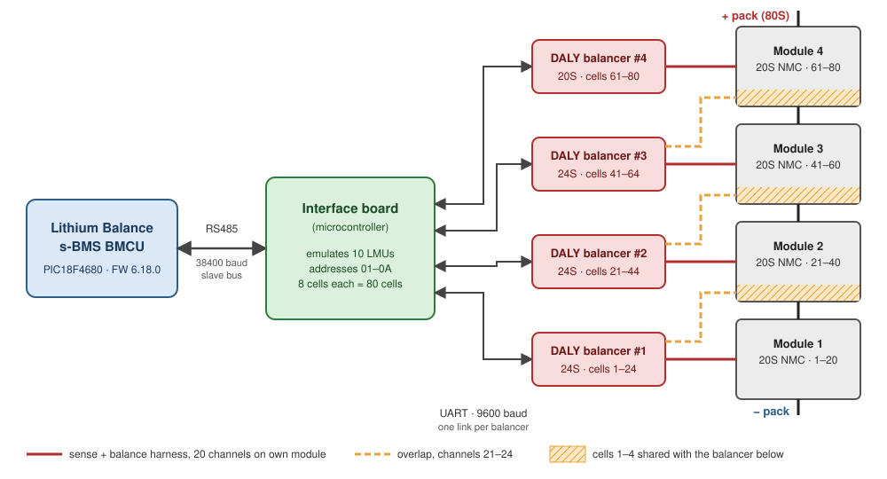

# Energica Ego (2018) — Replacement Battery BMS Interface

Replacement traction battery for a 2018 Energica Ego. The original Lithium Balance s-BMS
master (BMCU) stays in the bike. The original cell-monitoring slave boards are gone, and a
small microcontroller board takes their place.

## Battery

| Item | Value |
|---|---|
| Chemistry | NMC |
| Modules | 4, connected in series |
| Cells per module | 20 in series |
| Total | **80S** |

## System overview



- **BMS master:** Lithium Balance s-BMS **BMCU** board (firmware 6.18.0, PIC18F4680).
- **Original slaves (LMUs):** 10 Lithium Balance cell-monitor boards with 8 cells each
  (10 × 8 = 80 cells). They are no longer available.
- **Replacement:** 4 **DALY Smart Active Balancers**: three 24S (the largest model) and one
  20S for the top module. They balance the cells and measure every cell voltage.
- **Interface board:** a microcontroller that reads the cell voltages from the 4 DALY
  balancers and answers the BMCU's slave-bus requests as if it were the 10 original LMUs.
  The BMCU keeps running its stock firmware and sees no difference.

### Balancer wiring and module overlap

A balancer covering only one module could balance cells within that module but not move
energy between modules. Balancers #1–#3 are therefore 24S: 20 channels on their own module and
4 on the next module up. A balancer that spans a module boundary moves charge across that
boundary, so all 4 modules are pulled to the same level. Module 4 is at the top of the pack and
has no next module, so balancer #4 is a 20S unit on module 4 only. The module 3/4 boundary is
bridged by balancer #3.

```
 Global cell       1–20     |    21–40    |    41–60    |    61–80
 Module          Module 1   |  Module 2   |  Module 3   |  Module 4
 Balancer #1   [  ch 1–20  ] [21–24]
 Balancer #2                 [  ch 1–20  ] [21–24]
 Balancer #3                               [  ch 1–20  ] [21–24]
 Balancer #4                                             [  ch 1–20  ]
```

| Balancer | Model | Channels 1–20 | Channels 21–24 (overlap) | Global cells |
|---|---|---|---|---|
| #1 | 24S | Module 1, cells 1–20 | Module 2, cells 1–4 | 1–24 |
| #2 | 24S | Module 2, cells 1–20 | Module 3, cells 1–4 | 21–44 |
| #3 | 24S | Module 3, cells 1–20 | Module 4, cells 1–4 | 41–64 |
| #4 | 20S | Module 4, cells 1–20 | — | 61–80 |

### Cell mapping

The BMCU numbers cells by slave: global cell = (slave − 1) × 8 + index + 1. Each cell is
read from the balancer that owns its module (the **primary** reading). Cells in an overlap
zone are measured by a second balancer too, and the interface board compares the two
readings as a plausibility check. A large disagreement points to a sense-wire or
balancer fault.

| LMU (slave addr) | Global cells | Primary reading | Second reading |
|---|---|---|---|
| 1 | 1–8 | #1 ch 1–8 | — |
| 2 | 9–16 | #1 ch 9–16 | — |
| 3 | 17–24 | #1 ch 17–20 + #2 ch 1–4 | cells 21–24: #1 ch 21–24 |
| 4 | 25–32 | #2 ch 5–12 | — |
| 5 | 33–40 | #2 ch 13–20 | — |
| 6 | 41–48 | #3 ch 1–8 | cells 41–44: #2 ch 21–24 |
| 7 | 49–56 | #3 ch 9–16 | — |
| 8 | 57–64 | #3 ch 17–20 + #4 ch 1–4 | cells 61–64: #3 ch 21–24 |
| 9 | 65–72 | #4 ch 5–12 | — |
| 10 | 73–80 | #4 ch 13–20 | — |

### Temperature mapping

The interface board has 4 NTC inputs, one per module (T1 = module 1 … T4 = module 4), and each
DALY balancer reports its PCB temperature (balancer #n sits on module n). Each LMU fills its
four temperature registers like a real LMU (protocol doc §7.2):

| Register | Real LMU | Interface board |
|---|---|---|
| `0x7E5` | Pcb 1 | Balancer PCB temperature (DALY register `0x0043`) |
| `0x7E6` | Pcb 2 | Not fitted (`0x7A`) |
| `0x7E7` | Bat 1, NTC on L-J2 | Module NTC |
| `0x7E8` | Bat 2, optional NTC on L-J6 | Not fitted (`0x7A`) |

The BMCU ignores "not fitted" and uses the other two for its min/max/average. LMUs 3 and 8 span
a module boundary, so they report the mean of the two modules' values, rounded to the nearest °C.
A fault on either side wins over the mean.

| LMU | Module(s) | Bat 1 (`0x7E7`) | Pcb 1 (`0x7E5`) |
|---|---|---|---|
| 1, 2 | 1 | T1 | Balancer #1 |
| 3 | 1 + 2 | (T1 + T2) / 2 | (#1 + #2) / 2 |
| 4, 5 | 2 | T2 | #2 |
| 6, 7 | 3 | T3 | #3 |
| 8 | 3 + 4 | (T3 + T4) / 2 | (#3 + #4) / 2 |
| 9, 10 | 4 | T4 | #4 |

A balancer that hasn't answered for 2 s reports its PCB sensor as open (`0xD7`), on top of
the cell faults.

Value coding (see [s-BMS protocol §7.2](LithiumBalance_sBMS_RS485_Protocol.md)):

- Valid readings are clamped to −40 … +120 °C, so they never collide with the special codes.
- An open sensor (ADC near full scale) reports `0xD7` (low-side fault). A shorted sensor (ADC near
  0) reports `0x79` (high-side fault). Every LMU that uses that sensor reports the fault.
- LMUs 3 and 8 report a fault if either of their two sensors is faulty, so a broken sensor
  can't be hidden by the average.

## Repository contents

| Path | Description |
|---|---|
| [`LithiumBalance_sBMS_RS485_Protocol.md`](LithiumBalance_sBMS_RS485_Protocol.md) | BMCU ↔ slave-board RS485 protocol, reverse-engineered from the BMCU firmware: framing, CRC, addressing, start-up enumeration, cyclic polling, register map, value coding. |
| [`DALY_Active_Balancer_UART_Protocol.md`](DALY_Active_Balancer_UART_Protocol.md) | DALY active balancer UART protocol (D2 "Modbus" framing, with the classic A5 framing as fallback), compiled from DALY documents and community work. Not yet validated on hardware; see its §8. |
| [`BMCU 6.18.0.hex`](BMCU%206.18.0.hex) | BMCU application firmware image, the source of the s-BMS protocol analysis. |
| [`pic18_dis.py`](pic18_dis.py) | Minimal PIC18 disassembler (PIC18F4680 SFR names) used to analyse the firmware: `python3 pic18_dis.py "BMCU 6.18.0.hex" > bmcu.asm` |
| [`slave_sim/`](slave_sim/) | Python/Tkinter simulator of up to 32 s-BMS slave boards, plus a BMCU emulator and tests. Use it to check the protocol against the real BMCU before the interface board exists. See [`slave_sim/README.md`](slave_sim/README.md). |
| [`daly/`](daly/) | DALY balancer tooling. `fake_balancer.py` emulates a balancer (D2 protocol) on a USB-TTL adapter, for testing the firmware; see [Testing on the NUCLEO-G0B1RE](firmware/README.md#testing-on-the-nucleo-g0b1re). |
| [`docs/`](docs/) | Images used by this README (`system_overview.svg`). |
| [`hardware/interface_board/`](hardware/interface_board/) | KiCad 10 project of the interface board (draft): root sheet plus Power, MCU, BMCU (RS485), CAN, Temperatures, FANs, and one isolated balancer channel sheet used 4 times. PCB routed (first pass). Custom symbols are in `local.kicad_sym`, custom footprints in `lithium_balance.pretty` and `Molex.pretty`. |
| [`firmware/`](firmware/) | Interface board firmware in Rust (Embassy): s-BMS slave emulation, DALY polling, cell and temperature mapping. Compiles and is unit-tested on the PC; not yet run on hardware. See [`firmware/README.md`](firmware/README.md). |

## Protocol summary

| | s-BMS slave bus | DALY balancer |
|---|---|---|
| Physical | RS485, half-duplex, multi-drop | TTL UART (open-collector TX, needs pull-up) or RS485 |
| Format | 38400 baud, 8N1 | 9600 baud, 8N1 |
| Framing | ASCII hex: `CMD DEST SRC PAYLOAD CRC_H CRC_L CR` | Binary, 8-byte Modbus-like request (`0xD2` …) |
| CRC | CRC-16, poly 0xAC9A, init 0xFFFF (bytes 0x00/0x0D/0x1B bumped by 1) | CRC-16/Modbus |
| Role of the interface board | Slave (answers the BMCU) | Master (polls each balancer) |

On the s-BMS side the interface board has to:

1. Take part in the start-up enumeration. Each emulated LMU answers address `F0` in
   daisy-chain order and accepts its address `01`…`0A`.
2. Answer `q` reads of register `0x7D0` (8 cell voltages, uint16 big-endian, mV) and
   `0x7E5` (4 temperatures, int8 °C, see [Temperature mapping](#temperature-mapping)), and the
   one-time `0x7E0` read from slave 1.
3. Report missing or stale DALY data as a fault (for example `0x4000` for the affected cells, or no reply),
   so the BMCU's protection logic still works.
4. Build each LMU's 8 cells from the right balancer channels (see [Cell mapping](#cell-mapping)),
   and flag a cell as faulty when its two readings in an overlap zone disagree.

See the two protocol documents for the details.

## Hardware

> **Status:** proposed parts, not yet prototyped. Check the datasheets and current availability before
> ordering.

### Isolation concept

Each balancer's comm port is referenced to the negative of the module it sits on, so the 4
ports are at very different potentials:

| Balancer | Port ground ≈ | Highest cell ≈ |
|---|---|---|
| #1 | 0 V | 100 V |
| #2 | 84 V | 185 V |
| #3 | 168 V | 270 V |
| #4 | 252 V | 336 V |

The interface board therefore talks to each balancer over its **TTL UART** through its **own
isolator**. That gives 4 separate isolated domains, each isolated from the 12 V side too. This
doesn't depend on whether DALY's RS485 port is isolated (unknown), and each balancer has its own
link, so they don't need different addresses. The BMCU side stays non-isolated, because the BMCU
shares the bike's 12 V / chassis ground.

```
12 V ─► protection ─► buck 5 V ─► LDO 3.3 V ─► MCU (STM32G0B1KBT6) ◄── 8 MHz oscillator
                                                │
            BMCU (J3) ◄── RS485 transceiver ◄───┤ USART2            (12 V / chassis domain)
                  CAN ◄── CAN transceiver   ◄───┤ FDCAN1
          4 × NTC ──► filter / clamp       ───►─┤ ADC1 ×4
              8 × fan ◄── Q2 driver        ◄────┤ TIM1_CH1 PWM 25 kHz
                                                │
                    USART1, 3, 5, 6 (one each) ─┴─► 4 × ISO7721 ─► DALY UART #1..#4
                                                    (balancer side powered by the DALY connector)
```

### Bill of materials

| Function | Qty | Part | Notes |
|---|---|---|---|
| MCU | 1 | **STM32G0B1KBT6** (LQFP-32, 0.8 mm pitch) | Cortex-M0+ 64 MHz, 128 KB flash, 144 KB RAM. In 32 pins it still has one USART per balancer (no multiplexer), a USART with hardware RS485 DE, FDCAN, enough ADC inputs and timers. See [Pin assignment](#pin-assignment). Develop on a NUCLEO-G0B1RE (same chip family). Use the plain KBT6, not the "…TxN" variants. |
| Clock | 1 | X1, **Abracon ASE-8.000MHZ-LC-T** (8 MHz, 3.3 V CMOS output, ±50 ppm, −40…+85 °C, 3.2 × 2.5 mm) | Output to PC14 (OSC_IN); the firmware uses HSE bypass mode and the PLL to run at 64 MHz. The LQFP-32 has no OSC_OUT pin, so a passive crystal can't be used. Gives CAN the clock accuracy it needs (the internal HSI16 is only ±1 %). Pin 1 (enable) tied to 3.3 V. No capacitor of its own: C201 (100 nF), placed between X1 and the MCU's pin 4, decouples both. |
| MCU decoupling | 3 | C201 100 nF and C202 4.7 µF on VDD/VDDA (pin 4); C203 100 nF on NRST | |
| Status LED | 1 | D201 + R201 1 kΩ, on PB5 | |
| Balancer isolator | 4 | U601, U701, U801, U901: **TI ISO7721DWV** (wide-body SOIC-8, 5 kVrms reinforced) | 2 channels, one each way. Each side runs from 2.25–5.5 V, so it works whether the DALY supply is 3.3 V or 5 V. The balancer side is powered from the DALY UART connector. Equivalents: Si8621 (5 kV grade), ADuM1201. |
| MCU TX pull-up | 4 | R601, R701, R801, R901: 10 kΩ to 3.3 V | Holds each isolator input high (UART idle) while the MCU is in reset. |
| DALY TX pull-up | 4 | R603–R606: 10 kΩ to DALY VCC | DALY TX is open-collector. |
| Balancer-side decoupling | 4 | R602/R702/R802/R902 10 Ω in series on VCC, then C602/C702/C802/C902 100 nF + C603/C703/C803/C903 1 µF | Isolates the isolator from the long harness. Isolator side 1 has 100 nF (C601, C701, C801, C901). |
| BMCU RS485 transceiver | 1 | U301, **TI THVD1450D** (3.3 V, ±18 kV ESD, SOIC-8) | Half duplex. DE driven by USART2's hardware DE output, /RE tied to DE. R301 10 kΩ pulls DE low (driver off during reset); R303 10 kΩ pulls RO high (RX idle while the receiver is off). More robust option: SN65HVD1781-Q1 (automotive, ±70 V fault protection; needs 5 V). |
| RS485 protection | 1 | D301, SM712 TVS on A/B | |
| RS485 termination | 1 | R302, 120 Ω, **fitted** | Remove it if the BMCU end already terminates the bus. The THVD1450 has built-in fail-safe, so there are no bias resistors. |
| CAN transceiver | 1 | U401, **MCP2562-E/SN** (SOIC-8) | 5 V supply, logic-side supply pin (VIO) on 3.3 V. R401 10 kΩ pulls STBY high. |
| CAN protection | 1 | D401, NUP2105L | ESD on CANH/CANL. |
| CAN termination | 1 | R402, R403 2 × 60.4 Ω + C403 4.7 nF split termination, **DNP** | Fit it only if this node is at the end of the bus. |
| NTC front end | 4 | R501/R503/R505/R507 10 kΩ 1 % pull-up to 3.3 V, R502/R504/R506/R508 1 kΩ series + C501–C504 100 nF to the ADC pin, D501–D504 BAV99 clamp | For 10 kΩ NTC sensors. The sensors must be insulated from the cells and rated for the pack voltage: these inputs are on the 12 V side. |
| Programming header | 1 | J11, 2×5 shrouded box header, 2.54 mm (IDC) | Pinout of the common ST-LINK/V2 clone USB dongle, so it connects with the dongle's 10-wire ribbon cable. See [Programming header](#programming-header). |
| Debug header | 1 | J202, 1×2 pin header, 2.54 mm: 1 TX (PC6), 2 GND | LPUART2 debug console, TX only. |
| Input fuse | 1 | F101, polyfuse 0.5 A hold, 30 V (1812) | Electronics only: the fans have their own input (see [Fans](#fans)). |
| Reverse-polarity protection | 1 | D102, SS34 Schottky (3 A, SMA), in series after the fuse | |
| Input TVS | 1 | D101, **SMBJ24CA** (bidirectional), after the fuse | Load dump on the bike's 12 V. |
| Input decoupling | 2 | C101 10 µF 50 V (1210), C102 100 nF 50 V on +12 V | |
| Power LED | 1 | D103 (green) + R101 1 kΩ, on 3.3 V | |
| Fan power input | 1 | J18, Molex Mini-Fit Jr 2×3 right-angle (5569-06A2): 1, 4 GND; 2, 5 +12 V; 3, 6 not connected. 16 AWG wire | 8 A for 8 fans, 2 pins per polarity. Fused at the bike end with a 10 A blade fuse. Same part as the fan connectors. |
| Fan connectors | 4 | J14–J17, Molex Mini-Fit Jr 2×3 right-angle (5569-06A2) | 2 fans per connector, see [Fans](#fans) for the pinout. The fans' own 4-pin plugs connect through a short adapter harness; their tach wire isn't used. |
| Fan fuses | 8 | F102–F109, **Bel Fuse 0ZCF0200AF2C** (polyfuse, 2.0 A hold, 4.0 A trip, 24 V, 2920) | One per fan, so one shorted or stalled fan can't take down the others. The 2.0 A hold keeps margin over the 1 A fan as the hold current drops at high ambient temperature. |
| Fan rail capacitors | 2 | C1, C2, 47 µF 35 V electrolytic (6.3 × 7.7 mm SMD) | In parallel (94 µF); two small cans instead of one 100 µF for layout. Near J18 / along the fan power trace, grounded to the fan ground path. They only see the fans' motor commutation current, so a general-purpose series (≥ 150 mA ripple each) is enough. |
| Fan input TVS | 1 | D104, **SMBJ18A** (unidirectional), cathode on +12 V | Clamps spikes on the fan rail, e.g. from unplugging the fans under 8 A, to about 29 V, below C1/C2's 35 V rating. That is above the fuses' 24 V rating, but only for the microseconds of a spike; a fuse only has the supply voltage across it once it has tripped, and 12 V is well within 24 V. |
| Fan PWM driver | 1 | Q2, 2N7002DW (dual N-MOSFET, SOT-363) | See [Fans](#fans). Plus R202 100 Ω (gate series), R203 100 kΩ (gate pull-down) and R204/R205 10 kΩ (gate divider from the fan 12 V). |
| Fan ground link | 1 | R206, 0 Ω (0805), **DNP** | Joins `GNDPWR` to `GND` on the board. Not fitted: the grounds are joined in the harness, see [Fan ground](#fan-ground). |
| 5 V buck | 1 | U101, **Recom R-78E5.0-0.5** (7–28 V in, SIP3) | C103 10 µF and C104 1 µF on the output. The load is about 100 mA, mostly the CAN transceiver while it is transmitting. |
| 3.3 V LDO | 1 | U102, AP2112K-3.3 (SOT-23-5) | EN tied to VIN (always on). C105 1 µF on the output. |

### Connectors

| Ref | Function | Part | Pinout |
|---|---|---|---|
| J3 | BMCU: 12 V supply and RS485 slave bus | Molex Mini-Fit Jr 2×2 (0015247040) | 1 GND, 2 +12 V in, 3 RS485 A, 4 RS485 B |
| J1, J2, J5, J6 | DALY UART, balancers #1, #2, #3, #4 (isolated) | JST-GH 6-pin, right-angle (SM06B-GHS-TB) | 1 to DALY RX (command), 2 from DALY TX (response), 3–4 not connected, 5 DALY VCC, 6 DALY GND (B−) |
| J13 | CAN | Molex Micro-Fit 3.0 2×2 right-angle (43045-0400) | 1 CANH, 2 CANL, 3–4 GND |
| J19–J22 | NTC T1–T4 | Molex Micro-Fit 3.0 2-pin right-angle (43045-0200) | 1 NTC, 2 GND |
| J18 | Fan power input | Molex Mini-Fit Jr 2×3 right-angle (5569-06A2) | 1, 4 GND; 2, 5 +12 V; 3, 6 not connected |
| J14–J17 | Fans, 2 per connector | Molex Mini-Fit Jr 2×3 right-angle (5569-06A2) | See [Fans](#fans) |
| J11 | Programming (SWD) | 2×5 IDC box header, 2.54 mm | See [Programming header](#programming-header) |
| J202 | Debug console | 1×2 pin header, 2.54 mm | 1 TX (PC6), 2 GND |

The BMCU sheet also holds a drawing of the BMCU board (U1) and its connector J4 (Mini-Fit, 0015286042), for the 3D view only: neither is in the BOM nor fitted on the board.

### Pin assignment

As wired in the schematic (`mcu.kicad_sch`), checked against the `STM32G0B1KBTx` symbol in the
KiCad library. Check it again in STM32CubeMX.

| Function | Peripheral | Pins (LQFP-32 pin no.) |
|---|---|---|
| BMCU RS485 | USART2 TX / RX / DE (hardware driver enable) | PA2 (9), PA3 (10), PA1 (8) |
| Balancer #1 | USART1 TX / RX | PB6 (30), PB7 (31) |
| Balancer #2 | USART5 TX / RX | PB3 (27), PB4 (28) |
| Balancer #3 | USART3 TX / RX | PB2 (17), PB0 (15) |
| Balancer #4 | USART6 TX / RX | PA4 (11), PA5 (12) |
| CAN | FDCAN1 RX / TX, transceiver STBY | PB8 (32), PB9 (1), PA15 (26) |
| Temperatures 1–4 | ADC1_IN0, IN6, IN7, IN9 | PA0 (7), PA6 (13), PA7 (14), PB1 (16) |
| Fan PWM | TIM1_CH1 | PA8 (18) |
| Debug console (TX only) | LPUART2_TX | PC6 (20) |
| Programming | SWDIO / SWCLK / NRST | PA13 (24), PA14 (25), PF2-NRST (6) |
| Clock input | HSE (OSC_IN, bypass), from the 8 MHz oscillator | PC14 (2) |
| Status LED | GPIO | PB5 (29) |
| Spare | GPIO | PC15 (3), PA9 (19), PA10 (21), PA11 (22), PA12 (23) |

### Programming header

J11 is a 2×5, 2.54 mm shrouded box header with the pinout of the cheap **ST-LINK/V2 clone USB
dongles**: the aluminium USB-stick ST-LINKs. This is the clones' own pinout, not an ST or ARM standard. The
dongle's 10-wire IDC ribbon cable plugs straight in.

| Pin | Dongle signal | Board | |
|---|---|---|---|
| 1 | RST | NRST (PF2-NRST, pin 6) | |
| 2 | SWCLK | PA14 (pin 25) | |
| 3 | SWIM | not connected | STM8 only |
| 4 | SWDIO | PA13 (pin 24) | |
| 5, 6 | GND | GND | |
| 7, 8 | 3.3 V output | **not connected** | |
| 9, 10 | 5.0 V output | **not connected** | |

The dongle's 3.3 V and 5 V pins are supply *outputs* from the PC's USB port. They stay
unconnected: wired to the board's 12 V input they would back-feed the PC, and wired to the 5 V rail they would
fight the R-78E. Power the board from its own 12 V input while programming. There is no
target-voltage sense on this pinout; the dongle assumes 3.3 V, which matches the board.

A Nucleo's on-board ST-LINK can also be used, through jumper wires from its SWD header (CN4):
see [`firmware/README.md`](firmware/README.md#using-a-nucleos-st-link-for-the-interface-board).

PA9/PA10 are left unused because they also carry the USB-C dead-battery pull-downs, which are active
at reset. STBY has a pull-up, so the CAN transceiver stays in standby until the firmware enables it.

**Alternatives considered:**
- **STM32G031F8P6** (TSSOP-20): no CAN, and too few pins for the analog inputs and PWM.
- **STM32F042K6T6** (LQFP-32, with CAN): only 2 USARTs, so the 4 balancers would have to share
  one UART through a 74HC4052 multiplexer on the 3.3 V side. It's also an older family.

### Fans

8 standard 4-wire PC fans (12 V, 1 A each), all driven by one PWM signal. The tach outputs are
not used. The fans stop when their PWM line is grounded, and the board holds them stopped
while the MCU is in reset.

Q2 is a 2N7002DW: two N-MOSFETs in one package. Q2A (pins 1 S, 2 G, 6 D) is driven by the
MCU. Q2B (pins 4 S, 5 G, 3 D) grounds the fans' PWM line.

```
 12V_FAN ── R204 10k ──┬── R205 10k ── GND
                       │
                       ├── Q2B gate (5)     Q2B drain (3) ──► PWM pins of J14–J17
                       │                    Q2B source (4) ─► GND
                       └── Q2A drain (6)
 PA8 ── R202 100R ──┬── Q2A gate (2)        Q2A source (1) ─► GND
                    └── R203 100k ── GND
```

| State | PA8 | Q2A | Q2B | Fans |
|---|---|---|---|---|
| MCU in reset or unprogrammed | floating (R203 pulls the gate low) | off | on | **stopped** |
| Board 3.3 V missing, fan 12 V present | 0 V | off | on | **stopped** |
| Running, PWM high | 3.3 V | on | off | line floats high (the fan pulls it up internally): run |
| Running, PWM low | 0 V | off | on | line grounded: stop |

So the PWM duty cycle at PA8 is the fan speed: 0 % stops the fans, 100 % is full speed.

- **Q2B's gate** comes from the R204/R205 divider on the fan 12 V: about 6 V normally, and about
  15 V at the TVS clamp voltage. That's within the 2N7002's ±20 V gate rating. Q2B only has to sink the fans'
  pull-up current, at most about 5 mA per fan, 40 mA in total.
- **Fan power** doesn't go through the electronics' 12 V input. It has its own input (J18), a TVS
  (D104), 2 × 47 µF capacitors (C1, C2) and a polyfuse per fan. 8 A needs about 6 mm of trace width
  on 1 oz copper (about 10 °C rise), a copper pour, or 2 oz copper. The fan ground is its own net
  (`GNDPWR`) and returns to J18 on its own path. Q2, R203 and R205 are on `GNDPWR` too. See
  [Fan ground](#fan-ground).
- **Fan input J18** (Mini-Fit Jr 2×3, same part as the fan connectors): pins 1 and 4 GND, pins 2 and 5
  +12 V, pins 3 and 6 not connected.
- **Fan connectors J14–J17:** Mini-Fit Jr 2×3, 2 fans each (1 A per pin, well within the
  Mini-Fit Jr rating). Each fan's +12 V comes through its own polyfuse.

  | Pin | Signal | Pin | Signal |
  |---|---|---|---|
  | 1 | Fan A GND | 4 | Fan B GND |
  | 2 | Fan A +12 V | 5 | Fan B +12 V |
  | 3 | Fan A PWM | 6 | Fan B PWM |

  Adapter harness to each fan's 4-pin plug: GND → fan pin 1, +12 V → fan pin 2, PWM → fan pin 4;
  fan pin 3 (tach) is left open.
- **Bike supply:** 8 fans draw about 100 W continuously, more at start-up. Check that the Ego's
  12 V DC/DC converter can supply that on top of the bike's own loads.
- **Firmware:** 25 kHz (the 4-wire fan spec allows 21–28 kHz). Speed follows the hottest module
  temperature, and a faulty sensor runs the fans at full speed. See
  [`firmware/README.md`](firmware/README.md#fans).

#### Fan ground

The fan ground (`GNDPWR`, J18 pins 1/4) and the logic ground (`GND`, J3 pin 1) are **joined in
the harness, not on the board**, so the fans' 8 A return current never flows through the board's
signal ground (MCU, ADC, RS485 and CAN reference).

- **Where to join them:** at the bike's ground point, not at the BMCU. J3's GND is also the BMCU's
  ground and the RS485 reference; joining the fan ground there would send the fan current through
  it.
- **Q2A gate drive** is the only signal that crosses the two grounds: PA8 is referenced to `GND`,
  Q2A's source to `GNDPWR`. At the board, `GNDPWR` sits above `GND` by the drop on the fan return
  wire, about 0.25 V at 8 A for 1.5 m of 16 AWG plus contacts (about 0.5 V at start-up). Q2A then gets
  2.8–3.0 V of gate drive. That's enough for a typical 2N7002, since Q2A only sinks about 1.2 mA,
  but marginal for a worst-case part (Vgs(th) up to 2.5 V). Keep the fan ground wire short and
  heavy, or fit a lower-threshold dual N-MOSFET in the same SOT-363 footprint (Vgs(th) ≤ 1.5 V).
- **Broken wire:** with the fan ground open, the fans stop and `GNDPWR` floats towards 12 V; the
  only path to the logic side is R203 + R202 into PA8 (under 0.1 mA into its protection diode). With
  the logic ground open, the board loses its supply return. Neither damages anything.
- **Fallback:** R206 (0 Ω, DNP), near J18, joins the two grounds on the board. Fit it only if the
  harness join causes trouble; the fan ground wire must then still go back to the bike ground.

### PCB layout

2-layer board, 160 × 100 mm. Target: at least 6–8 mm creepage across each isolation barrier, a
slot under each isolator, and the 4 isolated domains kept apart from each other as well (#1 and #4
are about 250 V apart; balancer #4's domain is up to about 336 V from the 12 V side).

As routed (first pass):

- **Slots:** a 4.5 × 10.6 mm routed slot (Edge.Cuts) runs under each isolator (U601, U701, U801,
  U901), along the barrier.
- **Clearance, isolated domain to the 12 V side** (copper to copper, either layer): balancer #1
  8.05 mm, #2 8.05 mm, #3 7.43 mm, #4 7.93 mm. The closest points are `GND_BAL` to `GND` tracks.
- **Clearance between isolated domains:** at least 12.9 mm.

**Isolator fallback:** if the DALY connector supply turns out to be unusable: **TI ISOW7821**, a 2-channel
isolator with a built-in isolated DC/DC converter, fed from 5 V on the board side (about 70–100 mA
each). It has a different footprint and needs the 5 V rail at each isolator, so it means a board
revision.

### DALY UART connector checklist

The UART connector also powers the DALY Bluetooth dongle, so it should provide a supply
(probably 5 V). Check each balancer before you rely on it:

- [ ] **Pinout and voltage:** measure VCC against the connector GND with the balancer powered from
  its cells. Note which pins the Bluetooth dongle uses.
- [ ] **Load capability:** load VCC with about 10 mA (470 Ω at 5 V, 330 Ω at 3.3 V) and check that
  it doesn't sag.
- [ ] **Sleep behaviour:** check whether VCC stays on when the balancer sleeps. Either way, set the
  sleep time to 65535 (disabled), see [DALY protocol §1](DALY_Active_Balancer_UART_Protocol.md).
- [ ] **GND reference:** confirm the connector GND is the balancer's B− (cell 0).
- [ ] **RS485 isolation (for information):** measure the voltage and resistance between the RS485
  port's GND (or A/B) and B−. A few ohms or the same potential means not isolated. MΩ with no
  voltage suggests isolated, but that still doesn't tell you the voltage rating.

### Open points

- **Fan ground:** check on the bike that the fans run at the commanded speed with the grounds
  joined in the harness (Q2A gate margin, see [Fan ground](#fan-ground)).
- **Input TVS vs buck:** D101 (SMBJ24CA) clamps a load dump at about 39 V, above the R-78E's 28 V
  input rating.
- **ERC:** 2 errors and 11 warnings are left: J1 pins 3/4 without no-connect flags, two dangling
  wire stubs at the CANH/CANL labels on the CAN sheet, J6 pin 4 off-grid, X1 and GND symbols out
  of date with the library, and Q2's pins of type "unspecified".
- **DRC:** clean except one schematic-parity warning: the BMCU outline footprint U1 (3D view only)
  is on the board while its symbol is marked "not on board". The silkscreen checks are set to
  "ignore" in the board setup; turn them back on for a last check before ordering.
- **Temperatures:** confirm on a real balancer that DALY register `0x0043` is its PCB
  temperature (see [Temperature mapping](#temperature-mapping)).
- **CAN:** not used yet. The 8 MHz oscillator is fitted for it (FDCAN can be clocked straight from it). Before connecting it to the bike's bus, find out the bitrate and which
  IDs are in use, and keep the node silent (listen-only) until then.
- **Standby drain:** each isolator draws a few mA from its module through the balancer's
  regulator, well under 2 Ah per month. Keeping the balancer awake already costs more than that.
  For long storage, switch off the interface board's 12 V with the bike, so the balancers can
  sleep.

## Quick start (simulator)

```sh
pip install pyserial
python3 -m slave_sim.gui                          # GUI: emulate 10 slaves on a USB-RS485 adapter
python3 -m unittest slave_sim.test_protocol       # protocol unit tests
python3 -m slave_sim.fake_master --selftest       # BMCU emulator <-> simulator over a pty
```

## Status

- [x] s-BMS slave-bus protocol reverse-engineered from the BMCU firmware
- [x] Slave-board simulator and BMCU emulator
- [x] DALY balancer protocol reference compiled
- [ ] DALY protocol validated on a real balancer
- [ ] Inter-module balancing through the overlap verified
- [ ] DALY UART connector checked (see [checklist](#daly-uart-connector-checklist))
- [x] Interface board schematic drafted ([`hardware/interface_board/`](hardware/interface_board/))
- [x] Interface board PCB routed (first pass)
- [ ] Interface board schematic and PCB reviewed
- [x] Interface board firmware skeleton ([`firmware/`](firmware/)): compiles, logic unit-tested
- [ ] Firmware tested against the BMCU emulator and the real BMCU
- [ ] Test in the bike

## Safety

This is a high-voltage traction battery (80S NMC, about 300 V nominal). The BMCU makes its protection
decisions from the data this project feeds it. Wrong or stale cell voltages can hide an
over-charge or over-discharge. Validate everything on the bench before using it in the
vehicle.

Each balancer's sense harness spans a module boundary. If the pack has a service disconnect,
fuse or contactor between modules, the overlap wires bypass it. Fuse every sense lead at the
cell end, and remember that the harness can still be live when the modules are separated.
